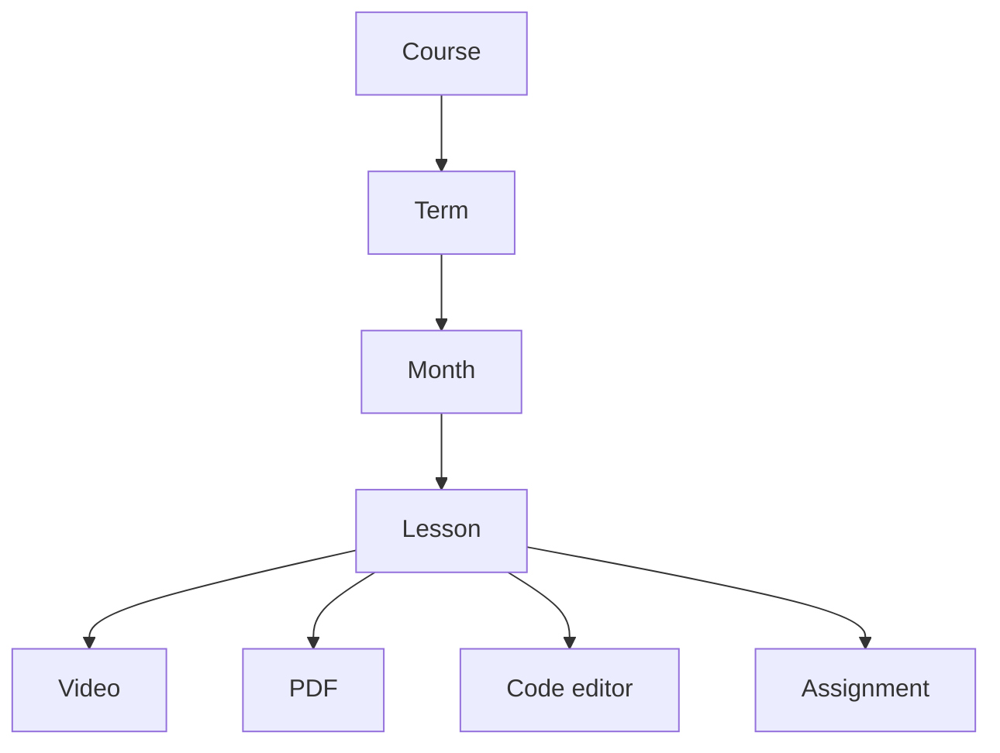
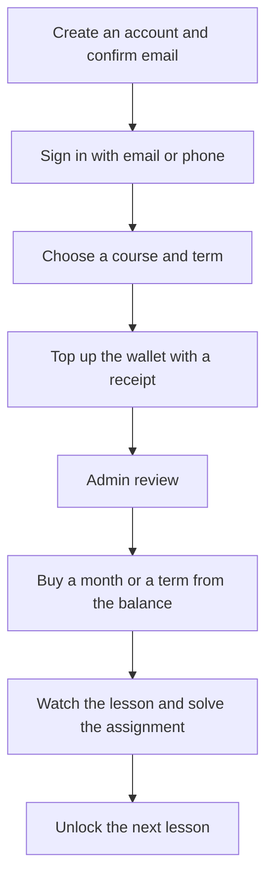
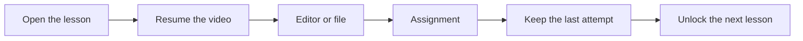
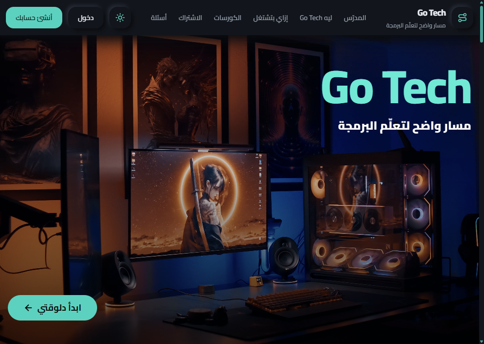
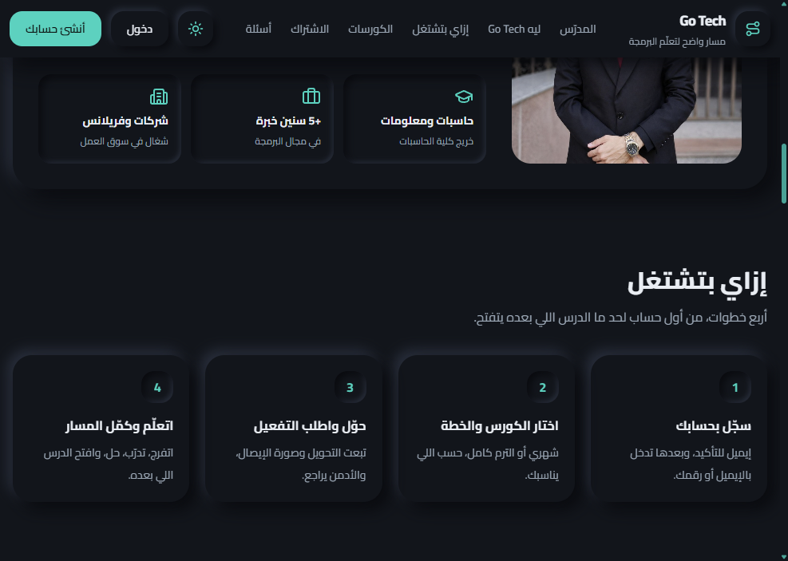
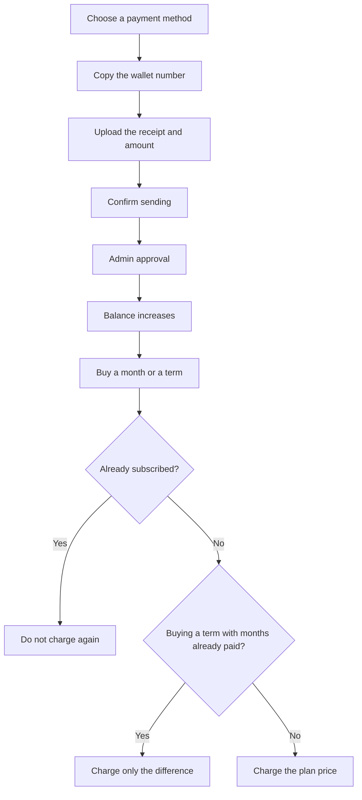

# Go Tech

An Arabic-first learning management system for Egyptian secondary students. Programming is taught as a clear path: watch a lesson, practice, pass the assignment, then unlock the next lesson.

The interface is Arabic and right-to-left. Courses are organized as course, term, month, and lesson. Students pay through an in-app wallet. Teachers run the platform from a separate admin dashboard.

## Idea

Students do not need a loose pile of videos. They need to know where they are in the syllabus, pay in a way that fits a family, and get an assignment graded immediately before the next lesson opens.

Go Tech keeps content, payment, and progress in one place. The teacher publishes courses and reviews deposits from the dashboard.

## Who it is for

- Secondary students learning programming
- The teacher or admin who publishes content and reviews payments
- A parent who wants a clear view of the subscription and progress

## Content structure

A month can be purchased on its own, or the whole term can be purchased at once. If a student already bought a month and later buys the full term, the price of that month is deducted from the term price.

## Student journey

After the email is confirmed, later sign-in uses email or phone number plus a password. There is no OTP on every login.

## Inside a lesson

- The video resumes from the last position the student reached
- The last assignment attempt stays visible and can be reviewed
- Lesson questions can be edited or deleted, and the admin name appears on replies
- The student name appears as a small moving watermark on the video

## Features

### Student

- Home overview with courses, completed lessons, balance, and notifications
- Courses filtered by school year
- Lessons with video, a PDF, and an HTML, CSS, and JavaScript editor
- Instant assignment grading, with the next lesson locked until the requirement is done
- Exams with a start time, a countdown, and automatic submission when time ends
- An in-account wallet: upload a top-up receipt, then buy a month or a term from the balance
- Egyptian wallets: Vodafone Cash, Orange Cash, WE Cash, Etisalat Cash, and InstaPay. The admin can add, edit, or delete any method
- Live sessions by school year, plus notifications
- Saved progress, and light or dark mode

### Admin

- Overview of students, courses, and payments
- Course builder: term, month, and lesson
- Assignments, questions, and question import
- Exams and attempt results
- Review of top-up receipts and balance approval
- Lesson questions and replies
- Live sessions targeted at one school year
- Notifications to students
- A security event log for lesson activity
- Watermark and payment-method settings

## Screens

The public site is dark, Arabic, and right-to-left.

### Landing

### Why the platform

### How it works

### Sign in

## Buying from the wallet

A subscription is not a separate manual transfer for every month. The student tops up the wallet once. The admin reviews the receipt. After approval, the balance is used to buy access.

A confirmation appears before every purchase or receipt upload. Going back to a month that was already bought does not charge the wallet again.

## Stack

| Layer | Choice |
| --- | --- |
| Student app and admin dashboard | React, TypeScript, and Vite |
| Styling | Tailwind CSS, Arabic RTL interface |
| Client state and data | Redux Toolkit Query |
| Database, auth, and files | Supabase |
| Hosting | Vercel |

The product is two apps: the student platform and the admin dashboard. Permissions and wallet charges run in the database, not only in the interface.

## Current limits

- The student community is paused
- Wallet top-ups are reviewed manually, then purchases are instant from the balance
- The running source code is in a private repository. This file is a public overview of the idea and features
